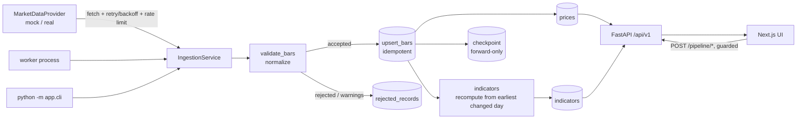

# Architecture (through Part 2)

## Key decisions and trade-offs

**Repository port, two adapters.** `Repository` (Protocol) has a `MemoryRepository` (default for local dev and most tests, no database needed) and a `SqlRepository` (PostgreSQL). Both implement identical semantics (idempotent upsert, forward-only checkpoints). The trade-off is two implementations to keep in sync; `tests/test_sql_repo.py` runs the same scenarios against Postgres.

**Idempotency.** Prices are keyed by `(instrument_id, interval, day)`. A re-fetch of identical bars is counted as `unchanged` (a "duplicate attempt") and writes nothing; a differing bar is `updated` (a historical correction). Rows are written with `INSERT .. ON CONFLICT DO UPDATE` in one transaction per symbol, so a failure rolls back that symbol only.

**Incremental ingestion.** Incremental runs fetch from `checkpoint - 7 days` so late vendor corrections are caught without refetching history. Checkpoints only move forward, so backfilling old ranges never rewinds them.

**Indicator recalculation.** After an upsert, indicators are recomputed from the earliest inserted/corrected day to the end (rows before it cannot change because every indicator uses only past data; verified by a prefix-stability test). The current implementation recomputes the full series in NumPy and replaces only the affected rows. A true incremental update (carrying EMA/Wilder state forward) is a future optimisation; measure first (`make benchmark`).

**Validation never drops silently.** Errors (non-positive/non-finite prices, bad OHLC, negative volume, duplicate or out-of-order timestamps) are stored in `rejected_records` with a code and the raw record. Suspicious-but-kept records (>40% close-to-close jump, adjusted > raw close) are stored as warnings.

**Retries.** Exponential backoff with full jitter, bounded attempts; non-retryable errors fail fast. A symbol that exhausts retries marks the run `partial` (other symbols continue) or `failed` (all symbols failed).

**Job control.** One ingestion job at a time per process (lock). Duplicate manual triggers get HTTP 409. API and worker are separate processes, so concurrent runs against PostgreSQL are possible but safe because writes are idempotent; a DB advisory lock is the next step if you need strict exclusivity.

**Operational endpoints.** `POST /pipeline/*` require `X-Admin-Token` when `MP_ADMIN_TOKEN` is set; with no token they work only when `MP_ENVIRONMENT=development` (the documented local demo profile). Errors never include stack traces.

**Price basis.** Trend/return indicators use `adj_close`; ATR uses unadjusted OHLC (needs a consistent high/low/close). The synthetic provider has no corporate actions, so both series are equal in demo mode.

**Annualisation.** Volatility uses 252 sessions/year and sample std of simple returns. Holidays are not modelled in the mock calendar or in staleness (lag counts weekdays).
